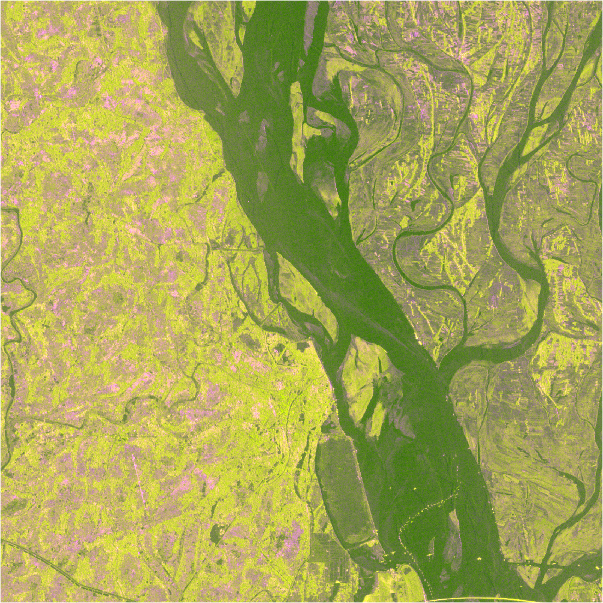
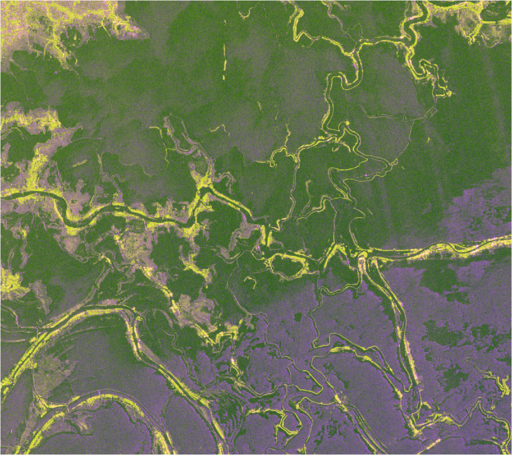
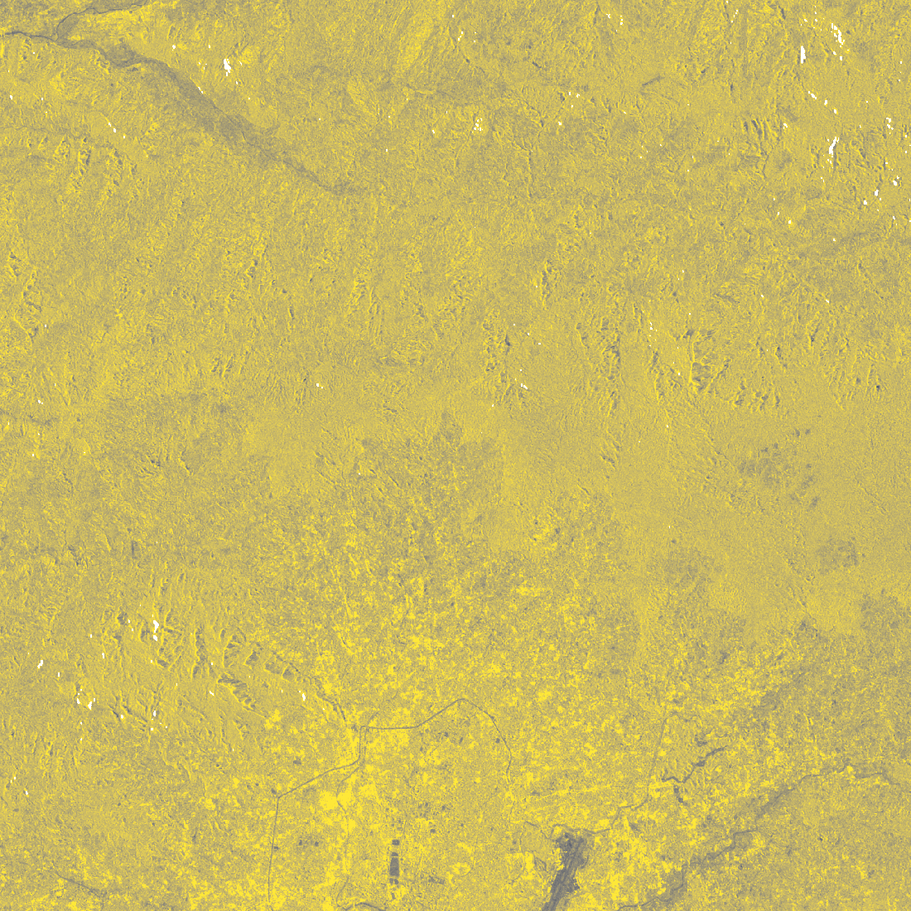
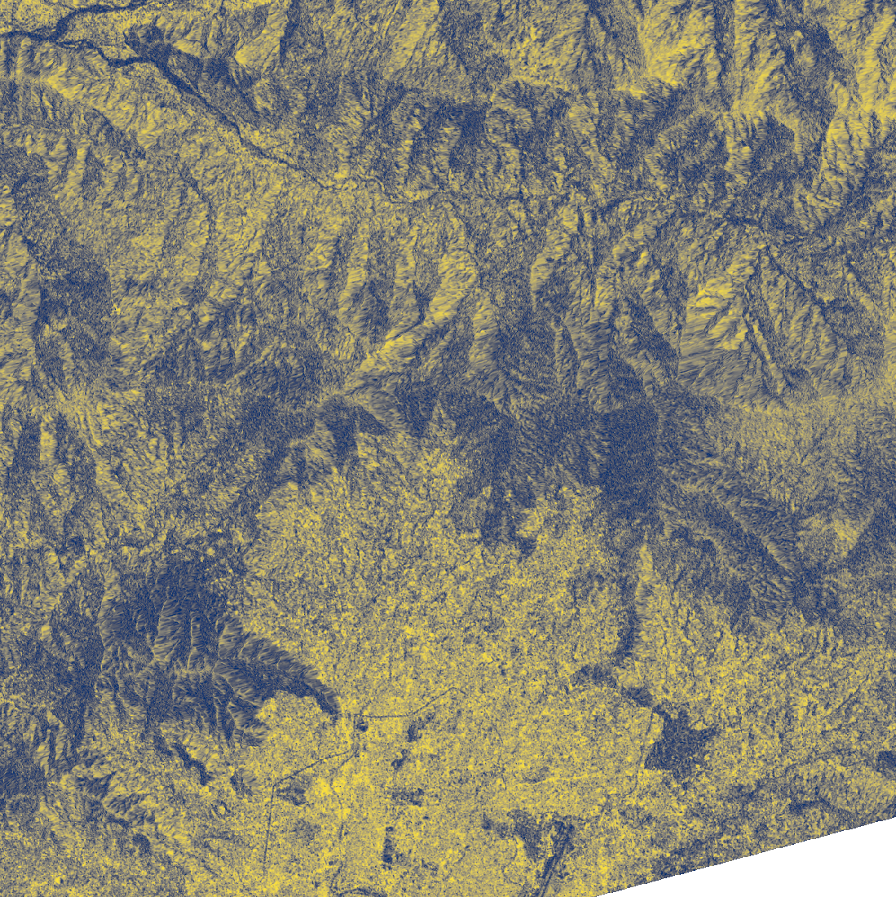
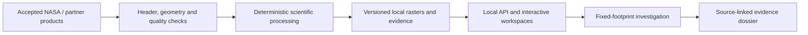

<p align="center"></p>

<p align="center"><strong>🛰️ Follow the change. Understand the pattern. Carry the evidence.</strong></p>

<p align="center">🌊 River Memory &nbsp; · &nbsp; 🌿 Wetland Pulse &nbsp; · &nbsp; 🏔️ Surface-change investigations</p>

<p align="center"><a href="#project-snapshots">Project snapshots</a> · <a href="#judges-tour">Judges’ tour</a> · <a href="#one-platform-two-countries">Explore the platform</a> · <a href="#run-terrapulse">Run locally</a> · <a href="#the-evidence-behind-the-story">Science & evidence</a> · <a href="docs/AI_USE.md">AI disclosure</a></p>

**TerraPulse** turns NASA–ISRO NISAR radar observations into interactive surface-change investigations across **Bangladesh and Nepal**. Follow a river corridor, explore a wetland, or investigate a disturbance that persists after its initial alert fades. Compare recorded visits, inspect the same physical footprint through time, examine competing explanations and export the evidence.

Built for **NASA Space Apps — Dancing with the SARs** by **DevAtMad**.

<a id="the-question-that-started-terrapulse"></a>

## 🔎 The question that started TerraPulse

### The alert disappeared. Did the landscape recover?

A small difference between two recent satellite visits can coexist with a lasting difference from an earlier reference. An alert becoming quieter is therefore a different question from the surface returning to its prior state.

TerraPulse makes that distinction visible. In the tracked Nepal footprint, the original alert contracts while the HH radar difference remains. The longer record follows that same footprint through October. The user can inspect the reference, the later observations, both polarization channels and the supporting context—and carry the complete evidence into an independent review.

**The outcome is a traceable investigation:** a location, a temporal record, the measurements behind it, possible explanations and a clear next question for follow-up.

<a id="project-snapshots"></a>

## 📸 Inside TerraPulse

Real outputs from the project's accepted satellite products. Click an image to inspect it at full size. These are scientific layer snapshots; their dates and meanings stay attached.

<table>
<tr>
<td width="50%"><strong>🌊 River Memory · Bangladesh</strong><br><sub>Jamuna / Sirajganj · 16 October 2026</sub></td>
<td width="50%"><strong>🌿 Wetland Pulse · Bangladesh</strong><br><sub>Tanguar Haor · 16 October 2026</sub></td>
</tr>
<tr>
<td><a href="docs/assets/jamuna-radar-composite.png"></a></td>
<td><a href="docs/assets/tanguar-radar-composite.png"></a></td>
</tr>
<tr>
<td>Follow radar-dark signatures along the river corridor. Compare where they appear, recede or persist.</td>
<td>Explore contrasting wetland radar responses across recorded visits and both polarization channels.</td>
</tr>
<tr>
<td><strong>🏔️ Surface change · Nepal</strong><br><sub>Kathmandu · 18 October 2026</sub></td>
<td><strong>🛰️ Coherence · Nepal</strong><br><sub>Kathmandu · 19–31 August 2026</sub></td>
</tr>
<tr>
<td><a href="docs/assets/nepal-surface-october.png"></a></td>
<td><a href="docs/assets/nepal-coherence-august.png"></a></td>
</tr>
<tr>
<td>Inspect the longer surface record and test whether a selected footprint still differs from its reference.</td>
<td>Examine pairwise radar phase consistency alongside intensity. Coherence alone does not measure displacement.</td>
</tr>
</table>

*Source: NASA–ISRO NISAR GCOV and GUNW, distributed through NASA Earthdata / ASF DAAC. Bangladesh colours combine HH, HV and their relationship; they are radar composites, not optical photographs or habitat classes. The Nepal panels show different measurements and dates. [Snapshot provenance](docs/assets/SNAPSHOTS.md).*

<details>
<summary><strong>🗺️ Explore terrain and scenario context</strong></summary>


The Nepal environmental workspace compares valley-focused and hillside-focused model responses. These are illustrative susceptibility indices, with assumptions and limitations displayed in the project. Separate Landsat thermal and optical layers add dated environmental context. [Methods and interpretation](docs/IMPLEMENTATION_06_07.md).

</details>

<details>
<summary><strong>🖥️ Interface archive · original Nepal comparison viewer</strong></summary>


This saved interface capture shows the earlier Nepal comparison viewer. The current application opens with country navigation and the expanded investigation workspaces described below; this archive is not a screenshot of the latest layout.

</details>

<a id="judges-tour"></a>

## 🧭 A short tour for judges

After [starting TerraPulse locally](#run-terrapulse), follow this route:

| Stop | Try this | The question it answers |
|---|---|---|
| **Bangladesh → River Memory** | Play the Jamuna visits, then inspect one fixed footprint. | Does a radar-dark signature recur at the same location? |
| **Bangladesh → Wetland Pulse / Surface change** | Switch to Tanguar and compare HH, HV and reference differences. | Do the channels tell the same story, and which explanations still fit? |
| **Nepal → Surface & coherence** | Follow a saved footprint through the longer record; inspect an available coherence pair. | Has the recent change become smaller while the earlier difference persists? |
| **Evidence dossier** | Export the selected investigation and inspect its sources and limitations. | Can another person retrace and challenge the conclusion? |

**What to look for:** the same physical footprint through time, actual acquisition dates, visible measurement units, competing explanations and a portable evidence record.

<a id="one-platform-two-countries"></a>

## 🌍 One platform. Two countries.

**Twenty unique GCOV acquisitions · four study windows · ten dates per country · two measured Nepal coherence pairs.** The two crops within each country share their source acquisitions; they are not four independent satellite series.

| Place | Workspace | What you can investigate |
|---|---|---|
| **Bangladesh · Jamuna / Sirajganj** | **River Memory** | Where radar-dark signatures appear, recede or persist between observed river-corridor visits. |
| **Bangladesh · Tanguar Haor** | **Wetland Pulse** | How dark and bright radar responses vary across a wetland landscape in both polarization channels. |
| **Bangladesh · either study area** | **Surface change** | Whether a selected footprint retains a difference, how the two channels respond, and what could explain the pattern. |
| **Nepal · Kathmandu & Rasuwa–Nuwakot** | **Surface & coherence** | The June–October intensity record, an explicit August reference and phase consistency between accepted acquisition pairs. |
| **Nepal · both investigation crops** | **Evidence dossiers** | Fixed-footprint persistence, competing explanations and geographically scoped independent references. |
| **Nepal · Kathmandu environmental study** | **Terrain & thermal** | Landscape context in 3D, Landsat temperature and optical imagery, and rainfall-assumption scenarios. |
| **Nepal · Kathmandu environmental study** | **Change DNA, slopes, timeline & comparison** | Radar signatures, sampled recovery, uncalibrated hillside susceptibility and paired-image inspection. |

Bangladesh Surface change uses the same Jamuna and Tanguar observations as the river and wetland workspaces. Environmental layers have their own dates, resolutions and coverage. The application identifies the scope of the selected evidence.


## ▶️ An investigation in four steps

1. **Choose a landscape.** Open the overview, select Bangladesh or Nepal and start with a question.
2. **Play the recorded visits.** Compare actual radar observations using consistent display scales. The primary timeline shows acquired dates only.
3. **Inspect a footprint.** Choose a saved region, click a native neighborhood or draw a polygon. Follow the same valid pixels across the record, compare reference and recent differences, and inspect explanations and available context.
4. **Export the evidence.** Save the selected measurements, footprint, observation identifiers, processing provenance, reference status and limitations in a dossier.

The interface supports keyboard map inspection, playback ranges, speed controls, looping, visible focus and reduced-motion preferences. Observation coverage is available under methods and in exports; unavailable acquisitions never become synthetic measurements.

<a id="the-evidence-behind-the-story"></a>

## 🔬 The evidence behind the story

TerraPulse keeps measurements, interpretation and scenarios distinct:

| Evidence | What it contributes |
|---|---|
| **NISAR GCOV · HH & HV** | Measured L-band backscatter, reference differences, preceding-visit changes and fixed-footprint traces. |
| **Dual-polarization relationships** | CPR, false-colour composites and exploratory scattering signatures, with cutoff sensitivity. |
| **Change DNA** | Signed changes, observed-visit persistence and sampled onset/recovery brackets on a fixed footprint. |
| **NISAR GUNW · Nepal** | Native pairwise HH coherence; phase-related downloads retain their units and quality metadata. |
| **NASADEM, Landsat & matched optical references** | Separately dated terrain, temperature, visible imagery and descriptive corroboration where suitable evidence exists. |
| **Deterministic explanation rules** | Supporting, contradicting and missing evidence for competing hypotheses. |
| **Scenario tools** | Transparent exploration of environmental assumptions using an explicitly uncalibrated susceptibility index. |

**What makes the workflow defensible:** actual acquisition dates, fixed spatial support, explicit references, native quality checks, versioned products, source identifiers and reproducible calculations. No runtime language model or remote inference computes the science.

The intended users are researchers, environmental teams and educators deciding where to investigate more closely. Operational decision accuracy, user adoption and field impact have not yet been established. Radar-dark candidates are not validated water or erosion; wetland signatures are not habitat diagnoses; coherence is not displacement; susceptibility is not a flood forecast.

<a id="run-terrapulse"></a>

## 🚀 Run TerraPulse

### 1. Get the source and processed runtime data

```bash
git clone --depth 1 https://github.com/mahdimahmud2006-coder/nasa101.git
cd nasa101
python3 scripts/fetch_runtime.py
```

**Repository access:** this repository is currently private. Authorized collaborators should sign in with [GitHub CLI](https://cli.github.com/) using `gh auth login` before cloning or downloading release assets. Judges need an invitation while access remains private.

The runtime installer downloads versioned assets from this repository’s release, checks their SHA-256 hashes and restores them without overwriting conflicting local files. Source, manifests and provenance live in Git; generated maps and native rasters are distributed separately. Raw satellite HDF5 files and Earthdata credentials are not required to view the processed project.

### 2. Create the environment and launch

```bash
python3 -m venv .venv
source .venv/bin/activate
python -m pip install -r requirements.txt
./run.sh
```

Open **[TerraPulse](http://127.0.0.1:8000/)**. Start at **Overview**, choose a country, then open an investigation. If that port is occupied:

```bash
./run.sh --host 127.0.0.1 --port 8001
```

Use the port printed by the server. Keep the terminal running; stop with **Ctrl+C**. Once dependencies and runtime data are installed, the application serves its saved evidence locally without Earthdata credentials or live NASA downloads.

### Optional: full native exports and local integrity check

```bash
# Additional full-resolution dual-polarization export rasters:
python3 scripts/fetch_runtime.py --full

# Verify installed core runtime data without a download:
python3 scripts/fetch_runtime.py --verify
```

For Windows, package details and hardware planning, see [Local setup](RELEASE_README.md). Use a current desktop browser; an SSD is useful for the scientific assets. Hardware recommendations are planning estimates, not validated benchmarks. See the runtime manifest for exact download and installation sizes.

## How it works



Acquisition is separate from viewing. The numerical methods live in `src/compute`; the local server reads accepted products and computes bounded footprint/scenario requests. The active record registry binds maps, timelines, context and APIs to the same observation sequence.

| Directory | Purpose |
|---|---|
| `src/ingest` · `src/compute` · `src/export` | Source interpretation, numerical methods and reproducible exports. |
| `src/api` · `web` | Local application, geographic navigation and interactive investigation tools. |
| `config*.json` · `claims` · `rules` | Explicit settings, active record bindings, claim ledger and explanation rules. |
| `tests` · `reports` · `reference` | Automated checks, retained evidence and frozen reference design. |
| `docs` | Methods, data provenance, implementation records and submission preparation. |

## ✅ Verification and reproducibility

```bash
# Source consistency and the JavaScript controller/model suites:
make check-web
make test-ui

# Python suite: requires the restored runtime for integration checks:
python -m pytest -q

# Publication checks; matched credential contents are never printed:
python3 scripts/audit_repository.py
```

Native validation reconciles source samples, masks, channel differences, valid visit counts, observed occupancy, footprint means and provenance hashes. Read-only checksum checks protect historical analytical products. Automated socket/DNS-denied handler checks support local delivery testing; rendered browser/accessibility/GPU acceptance and a physical disconnected rehearsal remain separate checks.

Full source reprocessing needs the original inputs described in [Dataset provenance](docs/DATASETS.md). Do not rebuild frozen destinations in place. Use a new product version and the [implementation plan](docs/PRODUCT_IMPROVEMENT_PLAN.md) for additional imports. Historical timing-report validators can write report files; consult the existing preservation wrappers before a full `make verify` run.

<details>
<summary><strong>Audit trail: the claim-to-evidence ledger</strong></summary>

<!-- CLAIMS:START -->
- **TP-DATA · measured** — Twenty unique GCOV acquisitions support four investigation study windows: ten Nepal dates and ten shared Bangladesh dates. The Bangladesh record includes all ten available nominal visits in the displayed June–October interval. Limitation: Both crops in each country share their source acquisitions. The August 5 Bangladesh slot is a permanent satellite outage. Historical products remain separately addressable.

- **TP-PERSIST · measured** — In the 199-pixel Nepal footprint, HH baseline differences remain −7.5263 and −7.0766 dB while centered-score retained alert area falls from 0.0199 km² to zero. Limitation: Alert contraction, baseline persistence and physical recovery are distinct; cause is unresolved.

- **TP-PAIR · measured** — Original nominal pair areas remain 0.0195, 0.7949 and 0.0000 km² under their original rule. Limitation: These are not the centered-score tracked-zone areas.

- **TP-CPR · measured** — The Nepal footprint has CPR baseline changes of +5.7152 dB and +4.6256 dB on the two follow-up visits. Limitation: CPR is HV−HH in dB, the sign reversal of the existing HH−HV relation; not independent corroboration.

- **TP-TERRAIN · measured** — Case-wide median slope is 1.9495° at Jamuna and 1.3598° at Tanguar. Limitation: Terrain/geometry screening and bounded hydrology are contextual models, not validated hazard or visibility classes.

- **TP-RAIN · planned** — Frozen IMERG Final-product rain totals remain unavailable. A later NASA catalog search found Late V07 candidates, but no scientific rainfall files were supplied or imported in this batch. Limitation: Exact UTC windows remain implemented. Missing rain stays null; catalog availability does not create precipitation measurements. NASA multisensor lineage still requires review before the strict source policy can accept an import.

- **TP-H1 · measured** — The August dip remains unresolved after frozen putative-control and full-source histogram tests. Limitation: Control shifts do not establish calibration error or physical cause.

- **TP-FIT · implemented** — Versioned deterministic rules show supporting, contradicting and missing evidence for competing explanations. Limitation: Uncalibrated compatibility statuses, no probability, winning cause or runtime LLM.

- **TP-DNA · measured** — Fixed-footprint Change DNA records signed channel changes, observed-visit persistence, onset/recovery brackets and censored recovery for saved or user-selected regions. Limitation: Numeric footprint records are dynamically recomputed with source/rule provenance; retrospective selection is not independent validation.

- **TP-MECHANISMS · hypothesized** — Low-return, paired brightening, moisture/roughness, vegetation, steep-source movement and radiometric explanations remain candidate hypotheses. Limitation: Signature compatibility does not uniquely identify a physical process.

- **TP-REFERENCE · measured** — The original frozen descriptive HLS comparison has eligible optical pixels in 14 of 54 footprint/date comparisons; 40 remain unavailable. The four added Bangladesh radar dates have no newly accepted optical matches. Limitation: Only the preselected geographic footprints and eligible pixels were assessed. Mixed results are retained; this is algorithmic optical context, not classification accuracy or causal validation.

- **TP-INTERFEROMETRY · measured** — Two supplied Nepal GUNW products now provide measured native 20 m and 80 m HH coherence for August 19–31 and August 31–September 12 in both Nepal crops. Limitation: Pairwise coherence is not displacement or a unique physical cause. Original Change DNA and Bangladesh retain their original unavailable coherence inputs. Reference-point, correction and unwrap checks are still required before LOS displacement.

- **TP-CONTEXT · measured** — The corridor intersects about 6.4230 km² of preliminary mapped mudflow/rockflow impact context. Limitation: This overlap does not establish detection accuracy, flood-water truth or field validation.

- **TP-METHOD · implemented** — Illustrative numerical settings describe measurements and display, not independently calibrated classes. Limitation: Configuration parameters must not be presented as validated physical thresholds.

- **TP-NAV · implemented** — Shared navigation and investigation links preserve supported case, observed date, saved or selected footprint, mode and layer state. Three Movements opens the existing measured evidence. Limitation: Nepal-only workspaces stay explicitly scoped. Unsupported legacy layers/footprints or missing dates are disclosed instead of being treated as equivalent data.

- **TP-ACCESS · implemented** — Keyboard map inspection and polygon vertices, visible focus, reduced-motion styles and live text evidence are implemented. Limitation: Source checks and mocked interactions do not establish real-browser, assistive-technology, GPU or whole-app WCAG conformance.

- **TP-LOCAL · measured** — Checked local page assets and representative reasoning requests work through the HTTP handler while Python sockets and DNS are forbidden. Limitation: This is a scoped automated backend/source check. Browser network behavior and a physically disconnected rehearsal remain unverified.

- **TP-DELIVERY · implemented** — The portable release builder includes current runtime rules, claims and local assets and checks every archive entry against its manifest. Limitation: Dependency installation, clean judging-machine startup, browser/physical rehearsal, public repository/video access and actual submission remain separate acceptance steps.

- **TP-EXTENDED-PERSIST · measured** — The original 199-pixel Nepal footprint remains common-valid across ten visits; its October 18 HH difference from August 19 is about −6.5660 dB. Limitation: This extends the measured backscatter record. Earlier visits vary relative to August 19, which is not a verified undisturbed baseline. No continuous persistence, physical damage or recovery is established.

- **TP-BD-RECORD · measured** — The ten-visit Bangladesh record recomputes HH/HV differences, dual-polarization signatures, observed occupancy, sensitivity, controls and fixed-footprint evidence. Only the August 5 nominal slot remains unobserved. Limitation: Added dates improve temporal sampling; they do not establish water, erosion, habitat, causal or hazard accuracy. No new coherence, scientific rain or thermal observations were supplied.
<!-- CLAIMS:END -->

</details>

## NASA data and attribution

- **NASA–ISRO NISAR GCOV:** primary radar intensity observations. [GCOV DOI](https://doi.org/10.5067/NIL2GCOV-P1) · [ASF product guide](https://nisar-docs.asf.alaska.edu/gcov/).
- **NASA–ISRO NISAR GUNW:** accepted Nepal coherence and phase-related products. [ASF GUNW guide](https://nisar-docs.asf.alaska.edu/gunw/).
- **NASA/USGS NASADEM:** historical terrain context. Source tiles and metadata are documented per case.
- **USGS Landsat and NASA HLS:** thermal/optical context and quality-screened descriptive references where available.
- **Independent preliminary impact mapping:** geographically scoped context, with publisher and source identifiers retained in the dossiers.

Providers and declared auxiliary lineage are reviewed under the project’s non-Chinese-source requirement. That review does not certify every contributor to a global auxiliary dataset. Provisional products, unavailable evidence, thresholds and reference limitations remain documented.

[Data provenance](docs/DATASETS.md) · [Methodology](docs/METHODOLOGY.md) · [Limitations](docs/LIMITATIONS.md) · [Field guide](web/guide.html)

## Team, AI use and next evidence

**Team: DevAtMad.** The project record documents the supplied datasets, implementation decisions, source reviews and verification. [AI assistance is disclosed](docs/AI_USE.md): Codex supported implementation, workflow design, tests and documentation; deterministic scientific code produces the measurements. Do not treat AI assistance as independent field validation.

The next priorities are independent corroboration, testing the workflow with intended users, additional compatible coherence pairs and a rehearsed judging-machine run. The [tracked improvement plan](docs/PRODUCT_IMPROVEMENT_PLAN.md) distinguishes implemented capability, missing inputs and manual acceptance. Competition eligibility and final submission have not been certified.

**License:** source code is [Apache-2.0](LICENSE). Satellite products, reference datasets and third-party assets retain their own attribution and license terms.

<p align="center"><strong>Observe the change. Question the explanation. Carry the evidence.</strong></p>
