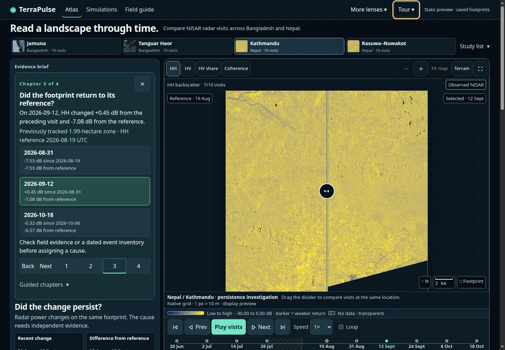
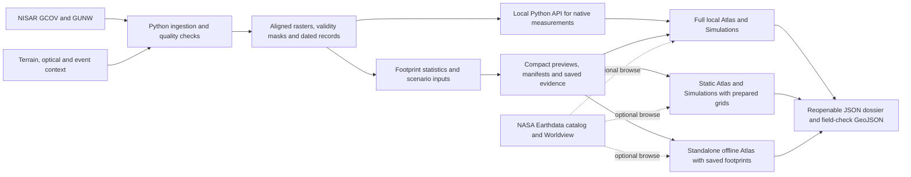
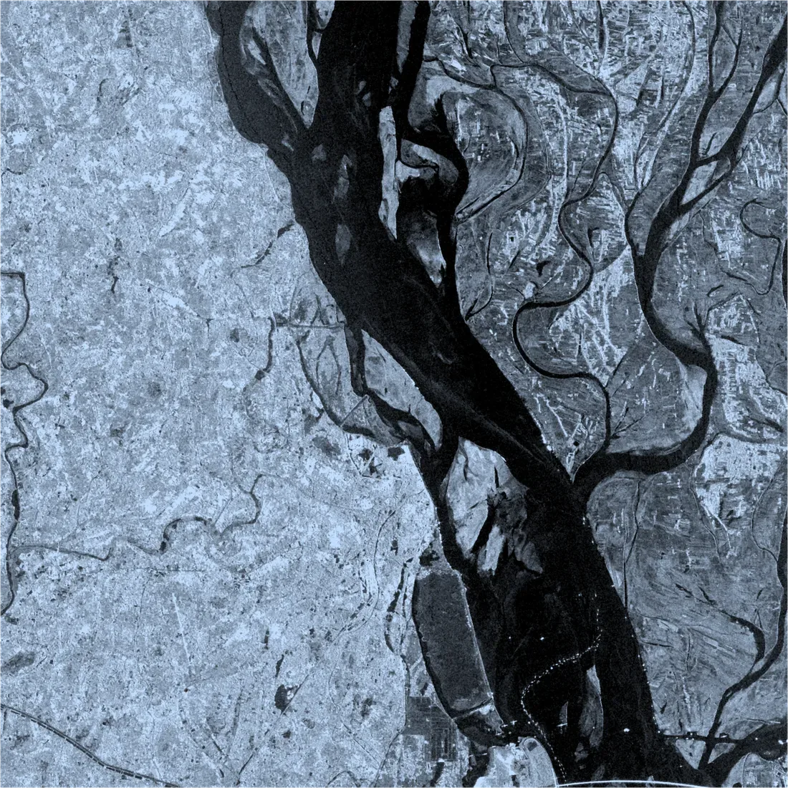
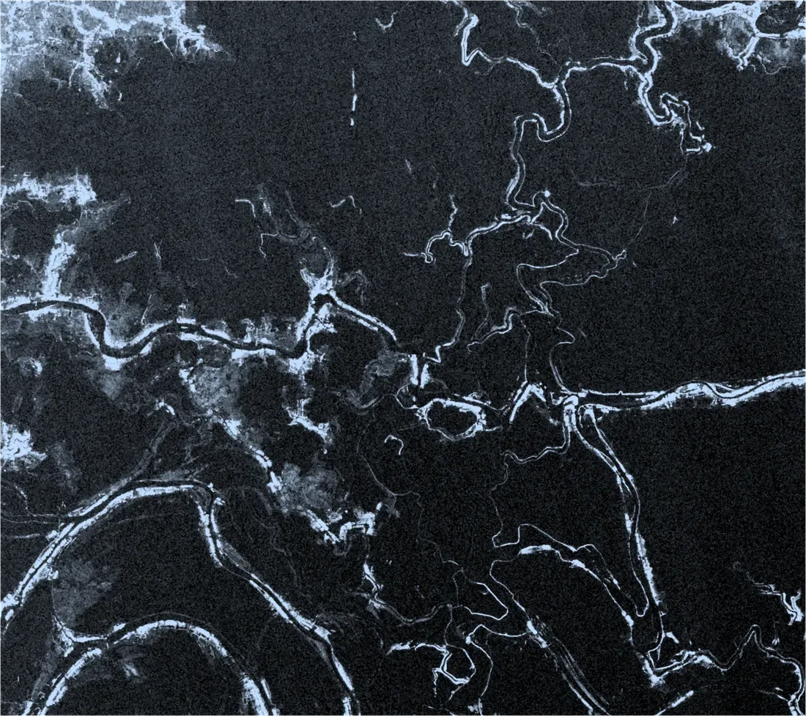
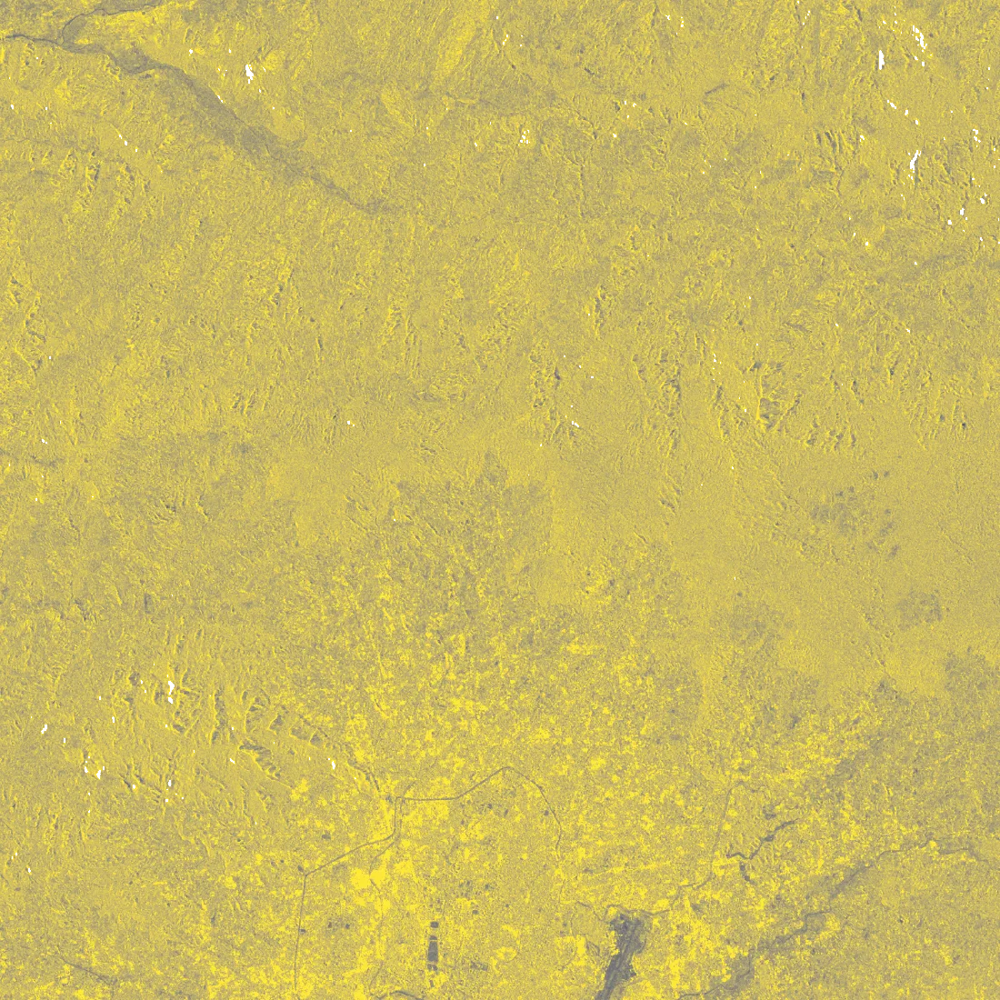
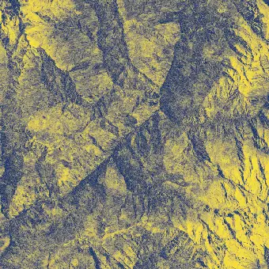
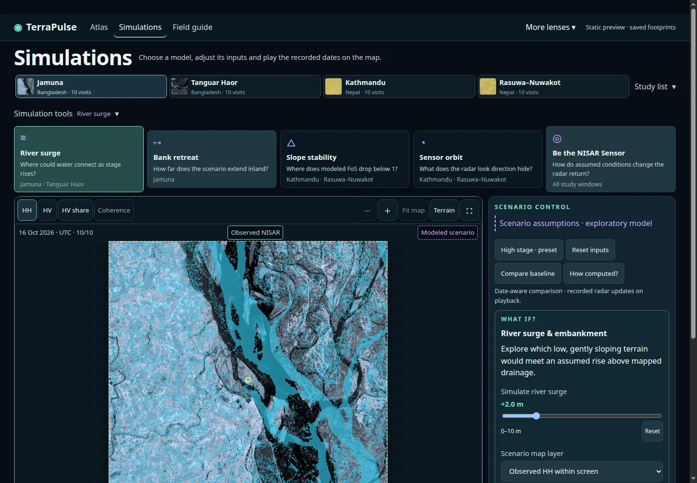

# TerraPulse

**An interactive NASA–ISRO NISAR atlas for investigating surface change across Bangladesh and Nepal.**

Built by **Team DevAtMad** for the **2026 NASA International Space Apps Challenge**, under **Dancing with the SARs**. The challenge asks teams to use NISAR radar observations to track surface change and communicate what they find through an interactive application. [NASA Space Apps 2026](https://www.spaceappschallenge.org/2026/) · [Challenge statement](https://hackathlone.com/challenges/dancing-with-the-sars)

[Run TerraPulse for judging](#how-to-use-terrapulse) · [Explore the four cases](#four-investigation-cases) · [See the measurements](#performance-and-verification) · [Read the methods](#how-terrapulse-calculates-change)

`NISAR` `SAR` `Python` `JavaScript` `HTML` `CSS` `Canvas` `NumPy` `SciPy` `Rasterio` `GDAL` `h5py` `PyProj` `Shapely` `PyArrow` `STAC` `pytest` `Node.js` `MIT`



*The Kathmandu chapter compares 12 September 2026 against the 19 August reference. The panel also shows how much the same footprint changed since 31 August. These two comparisons answer different questions.*

## What TerraPulse does

A single radar image can show a striking pattern. The next decision often depends on whether that pattern persisted at the same location, whether both radar channels tell a similar story, and which independent observation could clarify the cause. TerraPulse brings those questions into one workflow. Pick a study area, follow recorded visits on a fixed footprint, inspect the available context and export a dossier that another person can reopen.

| Setting | The practical problem | How TerraPulse helps |
| --- | --- | --- |
| **Bangladesh · Jamuna near Sirajganj** | A changing river edge can reflect river stage, exposed sediment or movement of the bank. A reviewer needs to decide which reach merits a closer survey. | Compare recurring low-return features at the same location. Take a dated footprint or transect to a follow-up with comparable river levels and independent banklines. [Jamuna River Sustainable Management Project](https://www.worldbank.org/en/news/press-release/2023/09/19/world-bank-helps-bangladesh-improve-riverbank-protection-and-navigability-of-the-jamuna-river) |
| **Bangladesh · Tanguar Haor** | Open water, flooded vegetation and other wetland surfaces can produce different or overlapping radar responses. Seasonal cloud can also leave gaps in optical coverage. | Compare HH and HV over recorded visits, review dated optical matches where available and identify where water depth or vegetation observations would help. [Tanguar Haor Ramsar information sheet](https://rsis.ramsar.org/RISapp/files/RISrep/BD1031RIS.pdf) |
| **Nepal · Kathmandu and Rasuwa–Nuwakot** | A surface can change little between recent visits while remaining different from its earlier reference. A field team also needs to know how a satellite signal relates to an independently mapped impact footprint. | Inspect recent change and reference difference together. In Rasuwa–Nuwakot, compare admitted radar pairs over the selected corridor and consult preliminary UNOSAT mapping as separate context. [UNOSAT impact assessment](https://unosat.org/products/4259/) |
| **Review across locations** | Large science files, different acquisition dates and inconsistent footprints make it hard to repeat someone else’s comparison. | The standalone Atlas embeds saved views for offline review. The dossier carries dates, reference, valid support and source identifiers into the next review. [Judging quickstart](docs/ATLAS_JUDGING_QUICKSTART.md) |

## Data and provenance

| Source | Contribution to TerraPulse |
| --- | --- |
| **NASA–ISRO NISAR Level 2 GCOV**, distributed by ASF DAAC | Provisional L-band HH and HV terrain-corrected backscatter. Twenty unique acquisitions support four study windows, with ten recorded visits per country. The two crops in each country share those acquisitions. [ASF GCOV guide](https://nisar-docs.asf.alaska.edu/gcov/) |
| **NASA–ISRO NISAR Level 2 GUNW**, distributed by ASF DAAC | Four unique admitted acquisition pairs across both countries support HH coherence views. Coherence describes radar phase consistency between the two dates. [ASF GUNW guide](https://nisar-docs.asf.alaska.edu/gunw/) |
| **NASA JPL NASADEM, NASA/USGS Landsat and NASA HLS** | Terrain and slope, dated Kathmandu surface-temperature context, and quality-screened optical comparisons. Clear optical coverage and acquisition offsets remain visible in the evidence. [NASADEM](https://doi.org/10.5067/MEaSUREs/NASADEM/NASADEM_HGT.001) · [USGS Landsat surface temperature](https://www.usgs.gov/landsat-missions/landsat-collection-2-surface-temperature) · [NASA HLS](https://hls.gsfc.nasa.gov/data-products/) |
| **NASA Earthdata CMR, Worldview and OPERA** | The discovery panel links to candidate Sentinel-1 surface-water products in Bangladesh and Landsat/Sentinel-2 disturbance products in Nepal. The panel shows the candidate dates and offsets, with browse links where checked imagery is available. [NASA CMR](https://cmr.earthdata.nasa.gov/search/site/docs/search/api.html) · [NASA JPL OPERA](https://www.jpl.nasa.gov/go/opera/products/) |
| **UNOSAT, ESA WorldCover and NASA POWER** | Preliminary Nepal impact context, historical land cover in selected screens, and regional meteorological context in Kathmandu. Each has its own source, date, scale and coverage. [UNOSAT](https://unosat.org/products/4259/) · [ESA WorldCover 2021 v200](https://doi.org/10.5281/zenodo.7254221) · [NASA POWER](https://power.larc.nasa.gov/) |

The timeline plays the acquisitions that exist. It marks the documented August outage and carries missing measurements as unavailable. Dossiers preserve the UTC endpoints, source granule IDs, product identity, footprint, quality support and limitations. The catalog links are leads for corroboration. A product match still needs a check of the local footprint, timing and valid coverage. [Dataset provenance](docs/DATASETS.md) · [Preview asset and licensing review](docs/ATLAS_ASSET_REVIEW.md)

## System design



The build checks product identity and compatible geometry before comparing observations. Numerical work uses the admitted analysis grid and validity masks. The browser uses resampled previews for display and reads the corresponding saved measurements. The full local API can compute a new point or polygon footprint against the native grids. [Methodology](docs/METHODOLOGY.md) · [Atlas schemas](contracts/README.md)

## How TerraPulse calculates change

| Calculation | What the Atlas computes |
| --- | --- |
| **Backscatter in decibels** | For a valid positive GCOV power sample $P$, $\gamma^0_{\mathrm{dB}} = 10\log_{10}(P)$. HH and HV are processed as separate channels. |
| **Change on common support** | For channel $c$, $\Delta_c(t,r)=\overline{c_{\mathrm{dB}}(t)}-\overline{c_{\mathrm{dB}}(r)}$. Both means use the same footprint pixels with valid HH and HV across the recorded visits. The reference $r$ is either the fixed baseline or the preceding recorded visit, depending on the comparison. |
| **HV power share** | For each paired-valid cell, $f_{HV}=P_{HV}/(P_{HH}+P_{HV})$ using linear power. The footprint summary averages those cell fractions. This is a derived view of the two channels. |
| **Area and valid coverage** | Coverage is valid cells divided by footprint cells. The projected support area multiplies valid cell count by the absolute affine grid determinant in square metres. A drawn polygon can also report its boundary area separately. |
| **Persistence and return** | Track the magnitude of the footprint’s HH difference from reference. Count assessable visits at or above the selected threshold. Bracket onset and any return below half the observed peak with recorded visit dates. If a return is absent by the last comparable visit, the record remains open. |
| **Coherence comparison** | Compare admitted GUNW pairs and subtract earlier coherence from later coherence where both pair products have valid support on the comparison grid. Read the pair dates and support with the result. |

**Worked case · Kathmandu, 12 September 2026.** The same tracked footprint contributes 199 paired-valid cells. The values below are the rounded readings shown in the Atlas. [Reproduce the Kathmandu result](docs/ATLAS_JUDGING_QUICKSTART.md) · [Replay notebook](web/atlas-replay.ipynb)

| Comparison | HH change (dB) | What the difference tells a reviewer |
| --- | ---: | --- |
| 12 September minus the preceding visit, 31 August | +0.45 | The return increased slightly between these visits. |
| 12 September minus the fixed reference, 19 August | −7.08 | The return remained well below the original reference. |

The scenarios calculate separate quantities under explicit assumptions. For river surge, cells must satisfy $HAND \leq \Delta H$ and terrain slope $\leq 8^\circ$ before the barrier test checks connectivity. In the Nepal slope tool, the simplified factor of safety compares resisting and driving terms.

$$
FoS = \frac{c' + (\gamma - m\gamma_w)z\cos^2\theta\tan\phi'}{\gamma z\sin\theta\cos\theta + k_h\gamma z}
$$

Here $c'$ is assumed cohesion, $\phi'$ friction angle, $z$ soil depth, $\theta$ slope, $\gamma$ and $\gamma_w$ soil and water unit weights, $m$ saturated-depth fraction, and $k_h$ the assumed horizontal acceleration coefficient. The model highlights cells with $FoS < 1$ under the selected inputs. The app labels these outputs as scenarios. [Scenario formulas, assumptions and limits](docs/ATLAS_SCENARIOS.md)

## Four investigation cases

The following images are actual NISAR display derivatives. Their dates, radar channels and granules are documented with the gallery. [Image provenance and benchmark record](docs/README_EVIDENCE.md)

### Jamuna · River Memory · Bangladesh



*HH backscatter on 16 October 2026. Dark areas show weak radar returns. River stage and other surface conditions can change where the apparent edge falls.*

- **Question.** Which dark signatures recur on the same part of the river corridor?
- **Try it.** Open Chapter 1 and play the 18 June–16 October record. Compare against 18 June, then use **Find comparison data** for the available OPERA surface-water views. The bank-retreat simulator lets you place a transect and examine resolved and ambiguous crossings.
- **Field follow-up.** Compare independently surveyed banklines at similar river stages before interpreting an apparent edge shift as bank erosion.

### Tanguar Haor · Wetland Pulse · Bangladesh



*HV backscatter on 16 October 2026. The contrast shows variation in cross-polarized return across the study window.*

- **Question.** How does the wetland’s radar response change between recorded visits?
- **Try it.** Open Chapter 2 for the 29 August footprint. Read the fitted reference and selected scenes side by side, switch HH and HV, and inspect optical context where clear support exists. The country record runs from 18 June to 16 October, using 18 June as reference.
- **Field follow-up.** Use water-depth and vegetation observations to distinguish plausible explanations for weak or bright returns. Recorded recurrence counts are tied to observed visits.

### Kathmandu · Surface-change investigation · Nepal



*HH backscatter on 18 October 2026. The guided case follows a saved footprint within this broader valley-and-hills study window.*

- **Question.** Did a tracked footprint return toward its August radar reference?
- **Try it.** Open Chapter 3 and compare 31 August, 12 September and 18 October on the same footprint. The Nepal record runs from 20 June to 18 October, with 19 August as the fixed reference.
- **Field follow-up.** Check dated optical or field evidence to investigate whether surface conditions recovered and what produced the radar change.

### Rasuwa–Nuwakot · Impact corridor · Nepal



*HH coherence for the 31 August–12 September 2026 pair. The display represents phase consistency across the pair on its own grid.*

- **Question.** Does pairwise radar similarity change on the selected corridor footprint and nearby ground?
- **Try it.** Open Chapter 4. Read the 19–31 August and 31 August–12 September pairs, inspect shared valid support, and open Context to compare them. The full local scenario can place preliminary UNOSAT mapping alongside the terrain screen.
- **Field follow-up.** Pair the radar evidence with independent observations of the affected corridor. Coherence can change with surface disturbance, vegetation, moisture and observation geometry. Estimating displacement requires a separate phase-processing and validation workflow. [UNOSAT map and assessment](https://unosat.org/products/4259/)

## Features

| Tool | What you can do |
| --- | --- |
| **Atlas and timeline** | Choose a study window, scrub or play acquired dates, change playback speed, and inspect HH, HV, HV power share or admitted coherence pairs. |
| **Map comparison and terrain** | Swipe the reference and selected visits, view two aligned panes for small saved footprints, or inspect relief with a NASADEM terrain view. |
| **Evidence inspector** | Compare against the prior visit and the fixed reference, examine coverage and onset or persistence, inspect possible explanations and look up dated comparison data. |
| **Footprints and exports** | Open saved footprints in every edition. Measure a point neighborhood or polygon in the full local edition. Export and reopen a JSON dossier, and export field-check GeoJSON where a field location is available. |
| **Guided review and accessibility** | Follow four case chapters or use the timed spotlight. Read observations as text or as a table, and use keyboard controls for key map and timeline interactions. |
| **River surge and embankment** | Change an assumed stage over drainage and test how an opening in a hypothetical barrier changes connected eligible terrain. |
| **Jamuna bank retreat** | Draw a transect, inspect observed crossings and test how assumed discharge and cycle settings affect a hypothetical retreat corridor. |
| **Slope stability** | Vary saturation, horizontal shaking and soil assumptions, and compare where modeled factor of safety falls below one. |
| **Sensor and orbit** | Vary incidence and look direction over Nepal terrain to explore shadow and layover. Compare illustrative L- and C-band phase sensitivity. |
| **Be the NISAR Sensor** | Vary moisture, standing water and canopy assumptions and compare the modeled HH/HV response with the observed footprint. |



*The Jamuna surge screen shows an exploratory +2.0 m stage setting against a recorded radar visit. The map distinguishes the modeled overlay from the observed NISAR backdrop.*

## How to use TerraPulse

### Offline Atlas for judges

Build a single HTML file with Python and open it in a desktop browser. The public source includes the saved observations for all four study windows. Setup requires no GitHub sign-in, Earthdata account, raw HDF5 granules or runtime archives. After building, you can open the Atlas offline without a server.

```bash
git clone --depth 1 https://github.com/mahdimahmud2006-coder/nasa101.git
cd nasa101
python3 scripts/package_atlas.py
```

You can also extract the [source ZIP](https://github.com/mahdimahmud2006-coder/nasa101/archive/refs/heads/main.zip), open a terminal in the extracted folder and run the Python command above. On Windows, use `py -3 scripts/package_atlas.py`.

1. Open `output/atlas/TerraPulse.html` in a desktop browser.
2. Choose **Tour → Start guided story** and open the Kathmandu chapter for **12 September 2026**. On the saved 1.99 ha footprint, HH rose **0.45 dB** since the preceding visit and was still **7.08 dB below** the 19 August reference.
3. Use the timeline and layer controls. Open **Context**, **Quality** or **Text** to inspect the dates, valid pixels and evidence behind the map.
4. Choose **Export → Investigation dossier**. Use **Reopen dossier** to restore and verify the saved investigation.

### Static judging bundle, if supplied separately

If you received a prepared judging bundle, extract it and open `START_HERE.md`. Serve its `static/` folder to use the simulations included with that build. External NASA Worldview links require internet access. [Judging quickstart](docs/ATLAS_JUDGING_QUICKSTART.md)

```bash
python3 -m http.server 8017 --bind 127.0.0.1 --directory static
```

Open [the static Atlas on port 8017](http://127.0.0.1:8017/).

### Full local edition

Use **Python 3.12+** and a desktop browser. The full edition adds native measurements and specialist workspaces. Restore the processed assets from the public runtime release (about 2.73 GB for the core archives), then restore or build the later Bangladesh coherence and simulation inputs before starting the server. [Runtime release](https://github.com/mahdimahmud2006-coder/nasa101/releases/tag/runtime-20261104) · [Runtime inputs and distribution](docs/REPOSITORY_AND_RUNTIME.md) · [Windows and local setup](RELEASE_README.md)

```bash
python3 scripts/fetch_runtime.py
python3 -m venv .venv
.venv/bin/python -m pip install -r requirements.txt
make check-ready
./run.sh
```

Open [the local Atlas on port 8000](http://127.0.0.1:8000/) or the address printed by the server. Run `make atlas-simulations` with the required inputs to build the scenario grids. Run `make atlas-static` to build a versioned static preview. [Build and release runbook](docs/ATLAS_RELEASE_RUNBOOK.md)

| Directory | Responsibility |
| --- | --- |
| `web/` | Browser Atlas, simulations, specialist views and compact saved evidence. |
| `src/ingest/`, `src/compute/`, `src/export/` | Source decoding, scientific calculations and product export. |
| `src/api/` | Local HTTP application, native footprint measurement and runtime checks. |
| `contracts/`, `claims/`, `rules/`, `config*.json` | Data and view schemas, measured claims, interpretation rules and accepted record bindings. |
| `scripts/`, `tests/`, `docs/` | Builds, automated verification, setup and scientific documentation. |

## Performance and verification

| What was measured | Result and scope |
| --- | --- |
| **Time to usable comparison** | **531.4 ms median**, **517.1–577.9 ms** across five cache-disabled desktop runs of static release `cb8a034621aa7903`. Chrome headless ran at 1440 × 1000 against the local preview server with 20 Mbps downstream pacing and 100 ms response delay. The marker waits for the selected and reference frames to decode. |
| **Initial static payload** | **474,928 bytes** of compressed response bodies in the release’s first-view inventory. The other cases and scenario inputs load when opened. |
| **Standalone HTML size** | **8,038,780 bytes** for the self-contained Atlas from that release. |
| **Automated verification** | Application revision `646394c` recorded **348** passing Python cases with its processed runtime. The JavaScript suite and offline dossier, playback and zero-network checks also passed on the staged source. |

These timings describe the local test profile and build, with latency and throughput conditions recorded alongside the individual runs. [Measurements and image provenance](docs/README_EVIDENCE.md)

```bash
make test-ui
make check-web
.venv/bin/python -m pytest -q
python3 scripts/generate_claims.py --check
python3 scripts/audit_repository.py
```

The JavaScript and standalone checks run from a source checkout. Some Python integration tests and static packaging checks need the processed runtime. Full scientific reproduction requires the accepted source datasets. [Independent validation protocol](docs/ATLAS_VALIDATION_PROTOCOL.md) · [Scientific limitations](docs/LIMITATIONS.md)

<details>
<summary>Claim-to-evidence ledger</summary>

<!-- CLAIMS:START -->
- **TP-DATA · measured** — Twenty unique GCOV acquisitions support four investigation study windows: ten Nepal dates and ten shared Bangladesh dates. The Bangladesh record includes all ten available nominal visits in the displayed June–October interval. Limitation: Both crops in each country share their source acquisitions. The August 5 Bangladesh slot is a permanent satellite outage. Historical products remain separately addressable.

- **TP-PERSIST · measured** — In the 199-pixel Nepal footprint, HH baseline differences remain −7.5263 and −7.0766 dB while centered-score retained alert area falls from 0.0199 km² to zero. Limitation: Alert contraction, baseline persistence and physical recovery are distinct; cause is unresolved.

- **TP-PAIR · measured** — Original nominal pair areas remain 0.0195, 0.7949 and 0.0000 km² under their original rule. Limitation: These are not the centered-score tracked-zone areas.

- **TP-CPR · measured** — The Nepal footprint has CPR baseline changes of +5.7152 dB and +4.6256 dB on the two follow-up visits. Limitation: CPR is HV−HH in dB, the sign reversal of the existing HH−HV relation; not independent corroboration.

- **TP-TERRAIN · measured** — Case-wide median slope is 1.9495° at Jamuna and 1.3598° at Tanguar. Limitation: Terrain/geometry screening and bounded hydrology are contextual models, not validated hazard or visibility classes.

- **TP-RAIN · planned** — Frozen IMERG Final-product rain totals remain unavailable. A later NASA catalog search found Late V07 candidates, but no scientific rainfall files were supplied or imported in this batch. Limitation: Exact UTC windows remain implemented. Missing rain stays null; catalog availability does not create precipitation measurements. NASA multisensor lineage still requires review before the strict source policy can accept an import.

- **TP-H1 · measured** — The August dip remains unresolved after frozen putative-control and full-source histogram tests. Limitation: Control shifts do not establish calibration error or physical cause.

- **TP-FIT · implemented** — Versioned deterministic rules show supporting, contradicting and missing evidence for competing explanations. Limitation: Uncalibrated compatibility statuses, no probability, winning cause or runtime LLM.

- **TP-DNA · measured** — Fixed-footprint Change DNA records signed channel changes, observed-visit persistence, onset/recovery brackets and censored recovery for saved or user-selected regions. Limitation: Numeric footprint records are dynamically recomputed with source/rule provenance; retrospective selection is not independent validation.

- **TP-MECHANISMS · hypothesized** — Low-return, paired brightening, moisture/roughness, vegetation, steep-source movement and radiometric explanations remain candidate hypotheses. Limitation: Signature compatibility does not uniquely identify a physical process.

- **TP-REFERENCE · measured** — The original frozen descriptive HLS comparison has eligible optical pixels in 14 of 54 footprint/date comparisons; 40 remain unavailable. The four added Bangladesh radar dates have no newly accepted optical matches. Limitation: Only the preselected geographic footprints and eligible pixels were assessed. Mixed results are retained; this is algorithmic optical context, not classification accuracy or causal validation.

- **TP-INTERFEROMETRY · measured** — Two supplied Nepal GUNW products now provide measured native 20 m and 80 m HH coherence for August 19–31 and August 31–September 12 in both Nepal crops. Limitation: Pairwise coherence measures phase consistency. Line-of-sight displacement requires corrected phase, a stable reference and independent checks.

- **TP-CONTEXT · measured** — The corridor intersects about 6.4230 km² of preliminary mapped mudflow/rockflow impact context. Limitation: This overlap does not establish detection accuracy, flood-water truth or field validation.

- **TP-METHOD · implemented** — Illustrative numerical settings describe measurements and display, not independently calibrated classes. Limitation: Configuration parameters must not be presented as validated physical thresholds.

- **TP-NAV · implemented** — Shared navigation and investigation links preserve supported case, observed date, saved or selected footprint, mode and layer state. Three Movements opens the existing measured evidence. Limitation: Nepal-only workspaces stay explicitly scoped. Unsupported legacy layers/footprints or missing dates are disclosed instead of being treated as equivalent data.

- **TP-ACCESS · implemented** — Keyboard map inspection and polygon vertices, visible focus, reduced-motion styles and live text evidence are implemented. Limitation: Source checks and mocked interactions do not establish real-browser, assistive-technology, GPU or whole-app WCAG conformance.

- **TP-LOCAL · measured** — Checked local page assets and representative reasoning requests work through the HTTP handler while Python sockets and DNS are forbidden. Limitation: This is a scoped automated backend/source check. Browser network behavior and a physically disconnected rehearsal remain unverified.

- **TP-DELIVERY · implemented** — The portable release builder includes current runtime rules, claims and local assets and checks every archive entry against its manifest. Limitation: Dependency installation, clean judging-machine startup, browser/physical rehearsal, public repository/video access and actual submission remain separate acceptance steps.

- **TP-EXTENDED-PERSIST · measured** — The original 199-pixel Nepal footprint remains common-valid across ten visits; its October 18 HH difference from August 19 is about −6.5660 dB. Limitation: This extends the measured backscatter record. Earlier visits vary relative to August 19, which is not a verified undisturbed baseline. No continuous persistence, physical damage or recovery is established.

- **TP-ATLAS-SCENARIOS · implemented** — The Atlas runs a buffered NASADEM stage screen with an assumed barrier opening in Bangladesh and an infinite-slope sensitivity calculation in Nepal. The stage screen can show observed NISAR HH below −19.5 dB and above −11.5 dB as display bins. Limitation: The bins are not a crop classification or forecast. Barrier connectivity is not flood routing. Coherence and preliminary mapped impacts do not change soil cohesion or verify modeled slope failure.

- **TP-ATLAS-SAR-LABS · implemented** — TerraPulse compares a simulated HH/HV scattering state with the observed footprint and visit, traces a Jamuna radar-dark edge across recorded visits, and tests look geometry and wavelength sensitivity on Nepal terrain. Limitation: The simulated canopy input is not measured biomass or DpRVIc. The Jamuna corridor is not a bank forecast. The opposite look and C-band responses are hypothetical; observed coherence uses the admitted NISAR pair.

- **TP-BD-RECORD · measured** — The ten-visit Bangladesh record recomputes HH/HV differences, dual-polarization signatures, observed occupancy, sensitivity, controls and fixed-footprint evidence. Only the August 5 nominal slot remains unobserved. Limitation: Added dates improve temporal sampling; they do not establish water, erosion, habitat, causal or hazard accuracy. The separate GUNW record provides paired coherence. Scientific rainfall and thermal data are separate evidence sources.
<!-- CLAIMS:END -->

</details>

## License and attribution

TerraPulse project code is released under the [MIT License](LICENSE). Scientific data, fonts and palettes retain their respective terms and credits. [Source and asset credits](docs/ATLAS_ASSET_REVIEW.md) · [Interface credits](docs/CREDITS_UI.md) · [AI contribution disclosure](docs/AI_USE.md)

## What comes next and why TerraPulse fits the challenge

- **Fit for Dancing with the SARs.** The investigation begins with repeated NISAR observations. Judges can change dates, compare channels and admitted pairs, and see the scientific reasoning behind each comparison. The radar simulator makes the effects of look direction and scattering assumptions visible. [Challenge statement](https://hackathlone.com/challenges/dancing-with-the-sars)
- **A strong use of open science data.** The same observations support repeatable comparisons, timeline playback, terrain context and dossiers with original granule IDs. Different data types retain their own dates, grid spacing and valid support, which lets reviewers check whether an apparent agreement is meaningful.
- **A real task in Bangladesh and beyond.** River teams can carry a specific Jamuna reach into a bank survey. Wetland teams can identify where to collect water-depth and vegetation observations in Tanguar. Nepal reviewers can prioritize a corridor footprint for an independent event or field check. The common workflow is useful wherever comparable radar observations and local reference evidence exist. [Bangladesh Flood Forecasting and Warning Centre](https://ffwc.gov.bd/) · [UNOSAT Nepal assessment](https://unosat.org/products/4259/)
- **A workflow people can try now.** A reviewer can open the offline Atlas, follow the four chapters, reproduce the Kathmandu comparison and exchange a dossier. The local edition extends the same workflow to a new point or polygon. [Judging quickstart](docs/ATLAS_JUDGING_QUICKSTART.md)
- **Next evidence to collect.** Match Jamuna banklines to measured river stage, collect date-matched wetland depth and vegetation observations, and review mapped and unmapped Nepal corridor footprints with local field teams. Use independent test footprints to quantify detection errors, then test the browser workflow and dossier handoff with first-time users. [Validation protocol](docs/ATLAS_VALIDATION_PROTOCOL.md)
